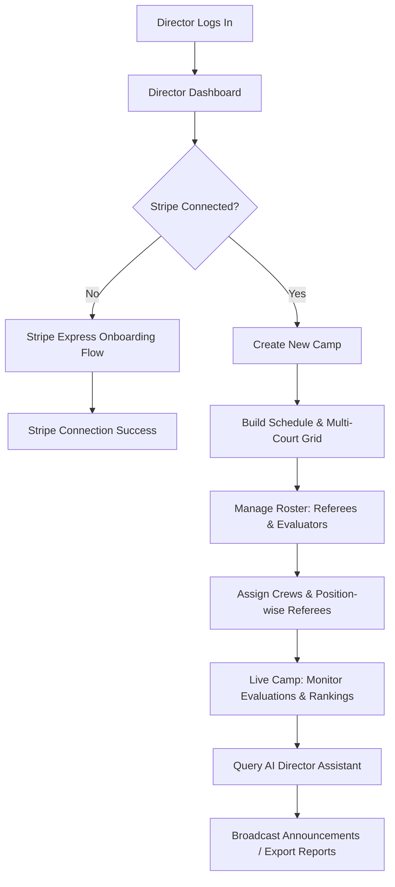
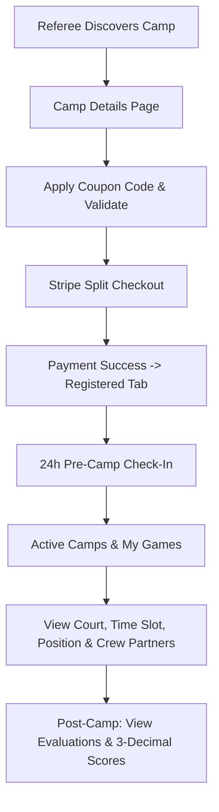
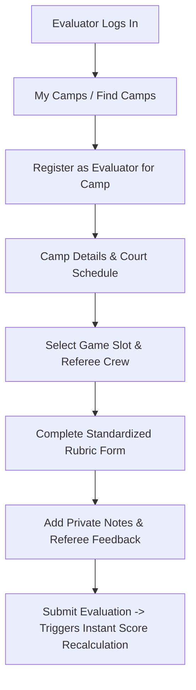
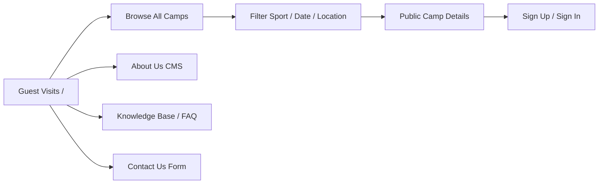
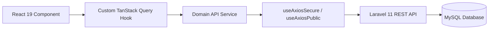

# WhistleWorks 🏆

> **The Premier Sports Officiating, Referee Camp Management, Evaluation & Game Scheduling Platform**  
> Streamlining the entire lifecycle of sports referee development camps — from multi-court scheduling and position-wise crew assignments to real-time rubric evaluations, Stripe Connect direct payouts, and cross-camp AI intelligence.

[](https://react.dev/)
[](https://vitejs.dev/)
[](https://tailwindcss.com/)
[](https://tanstack.com/query)
[-729b1b?logo=vitest&logoColor=white)](https://vitest.dev/)
[](https://ant.design/)

---

## 📋 Table of Contents

- [WhistleWorks 🏆](#whistleworks-)
  - [📋 Table of Contents](#-table-of-contents)
  - [🌟 Platform Overview](#-platform-overview)
  - [👥 Core User Roles \& Permissions](#-core-user-roles--permissions)
  - [🔄 Comprehensive User Flows](#-comprehensive-user-flows)
    - [1. Camp Director Flow](#1-camp-director-flow)
    - [2. Referee / Official Flow](#2-referee--official-flow)
    - [3. Evaluator / Clinician Flow](#3-evaluator--clinician-flow)
    - [4. Public Guest \& Discovery Flow](#4-public-guest--discovery-flow)
  - [⚡ Deep Dive: Flagship \& New Features](#-deep-dive-flagship--new-features)
    - [🤖 AI Director Assistant (`/director-dashboard/ai-assistant`)](#-ai-director-assistant-director-dashboardai-assistant)
    - [🎯 Position-Wise Referee Assignment](#-position-wise-referee-assignment)
    - [📊 Standardized Rubric Evaluations \& 3-Decimal Precision](#-standardized-rubric-evaluations--3-decimal-precision)
    - [💳 Stripe Connect Direct Split Payouts \& Coupons](#-stripe-connect-direct-split-payouts--coupons)
    - [🛡️ Role-Isolated API Endpoints (Previous Camps)](#️-role-isolated-api-endpoints-previous-camps)
    - [🔔 Real-Time In-App Notification Center](#-real-time-in-app-notification-center)
    - [📨 Public Support \& Contact Us Form](#-public-support--contact-us-form)
  - [🏗 System Architecture \& Tech Stack](#-system-architecture--tech-stack)
    - [Technology Stack](#technology-stack)
    - [Data Flow Architecture](#data-flow-architecture)
    - [HTTP \& Authentication Architecture](#http--authentication-architecture)
  - [📁 Repository Directory Map](#-repository-directory-map)
  - [🗺 Comprehensive Route Map](#-comprehensive-route-map)
    - [Public \& Informational Routes](#public--informational-routes)
    - [Authentication Routes](#authentication-routes)
    - [Camp Director Suite (`/director-dashboard`)](#camp-director-suite-director-dashboard)
    - [Evaluator Portal (`/evaluator-dashboard`)](#evaluator-portal-evaluator-dashboard)
    - [Referee Portal (`/referee-dashboard`)](#referee-portal-referee-dashboard)
  - [🚀 Getting Started \& Local Setup](#-getting-started--local-setup)
    - [Prerequisites](#prerequisites)
    - [1. Clone \& Install Dependencies](#1-clone--install-dependencies)
    - [2. Environment Variables Setup](#2-environment-variables-setup)
    - [3. Running Development Server](#3-running-development-server)
    - [4. Production Build \& Preview](#4-production-build--preview)
  - [🧪 Testing Suite \& Quality Assurance](#-testing-suite--quality-assurance)
    - [Test Coverage Summary](#test-coverage-summary)
    - [Running Tests](#running-tests)
    - [Vitest Global Setup \& Mocking Guidelines](#vitest-global-setup--mocking-guidelines)
  - [📘 New Developer Onboarding Guide](#-new-developer-onboarding-guide)
    - [Code Conventions](#code-conventions)
    - [How to Implement a New Feature (Step-by-Step Playbook)](#how-to-implement-a-new-feature-step-by-step-playbook)
    - [Troubleshooting Common Issues](#troubleshooting-common-issues)
  - [📄 License \& Credits](#-license--credits)

---

## 🌟 Platform Overview

**WhistleWorks** is an end-to-end sports technology platform specifically engineered for basketball, soccer, volleyball, and multi-sport officiating camps. Running a referee camp involves severe operational bottlenecks: scheduling dozens of courts, assigning officiating crews with balanced mechanics experience, collecting registrations, issuing evaluator scorecards, generating weighted rankings, and distributing payouts.

WhistleWorks unites all stakeholders in a single responsive web application:
- **Camp Directors** gain total command over multi-day schedules, court allocations, automated slot assignment, direct Stripe Express payouts, and an interactive **AI Director Assistant** for cross-camp analytics.
- **Referees** discover top clinics, register with promo codes, check in 24 hours prior, track real-time game court assignments, and receive actionable evaluator scorecards.
- **Evaluators** score officials on court positioning, call accuracy, and game control using standard rubrics, providing both private director notes and constructive official feedback.

---

## 👥 Core User Roles & Permissions

| Role | Primary Objectives | Dashboard Route | Key Permissions |
| :--- | :--- | :--- | :--- |
| **Camp Director** | Create camps, staff courts, assign crews, review live evaluations, calculate rankings, manage Stripe direct payouts, and query AI assistant. | `/director-dashboard` | • Full camp CRUD<br>• Court & slot generation<br>• Position-wise crew assignment<br>• Stripe Express onboarding<br>• Announcement broadcasts<br>• AI Director Assistant query access |
| **Referee (Official)** | Find camps, register with split payment, check in on game day, view schedule & partner crews, review performance scorecards. | `/referee-dashboard` | • Camp registration & checkout<br>• 24h game day check-in<br>• Assigned game slot & partner crew views<br>• Evaluation history & 3-decimal score reports<br>• Past camp records |
| **Evaluator (Clinician)** | View assigned court games, assess referee mechanics & control, submit standardized scorecards, recommend advancement levels. | `/evaluator-dashboard` | • Camp discovery & registration<br>• Court-specific game schedule viewer<br>• Rubric scoring & feedback submission<br>• Real-time camp roster inspection<br>• Past evaluation history |
| **Public Guest** | Discover camps by sport/state, read official itineraries, view FAQ and company story, submit contact requests. | `/` (Root Layout) | • Unauthenticated camp search<br>• Itinerary & pricing preview<br>• Contact form transmission<br>• Public CMS knowledge base |

---

## 🔄 Comprehensive User Flows

### 1. Camp Director Flow



1. **Onboarding & Stripe Connect**: Director connects their Stripe account via Stripe Connect Express to receive registration funds directly.
2. **Camp Creation**: Director configures camp dates, location (Google Places Autocomplete), sport type, software & camp fees, and rich Tiptap overview.
3. **Schedule & Court Matrix**: Sets daily operational hours, court names (Court 1, Court 2, etc.), game slot durations, and concurrent game limits.
4. **Position-wise Staffing**: Organizes referees into 2-person or 3-person crews, assigning specific court positions (*Lead, Center, Trail* for Basketball, or *Center Referee, AR1, AR2* for Soccer).
5. **Live Camp Oversight**: Observes live evaluator submissions, reviews real-time rank lists, updates ranking criteria weights, and broadcasts urgent announcements to courts.
6. **AI Analytics**: Uses the **AI Director Assistant** to compare referee mechanics across multiple camps, find top performers, or inspect evaluator consistency.

---

### 2. Referee / Official Flow



1. **Discovery & Registration**: Referees browse public camps or use `/referee-dashboard/find-camps` with filters (sport, date, location).
2. **Checkout & Split Payments**: Optional discount coupons are validated against the backend (`/v2/referee/camp/:id/validate-coupon`). The payment is split: camp fee goes directly to the Director, while software fee goes to the platform.
3. **Pre-Camp Check-In**: Exactly 24 hours prior to camp start, the check-in button activates. Checking in confirms active attendance.
4. **Game Assignments**: Referee accesses **My Games** to view assigned game slots, assigned court number, officiating position (e.g., *Crew Chief*, *Umpire*), and partner crew members.
5. **Scorecards & Development**: Once evaluators submit grades, the referee inspects detailed breakdowns across 6 metrics (Call Accuracy, Mechanics, Communication, etc.) with exact 3-decimal averages.

---

### 3. Evaluator / Clinician Flow



1. **Staff Registration**: Evaluator selects upcoming camp and requests evaluator registration.
2. **Schedule Inspection**: Views court schedules and assigned referee pairings for each game slot.
3. **Scoring Rubric**: Evaluates each assigned official on:
   - Call Accuracy
   - Consistency of Calls
   - Court Positioning & Mechanics
   - Game Awareness & Control
   - Fitness & Mobility
   - Communication Skills
4. **Private vs Public Feedback**: Evaluator enters private notes reserved exclusively for the Director's eyes, and constructive notes shared with the official.
5. **Advancement Recommendation**: Selects recommended advancement level (e.g., *High School Varsity, Junior College, NCAA D3, NCAA D1*).

---

### 4. Public Guest & Discovery Flow



1. Guests explore upcoming camps without an account.
2. Interactive search, location filtering, and sport categorization narrow down options.
3. Informational public CMS pages provide company history (`/about-us`), searchable FAQ accordions (`/faq`), platform updates (`/whats-new`), and public contact inquiry routing (`/contact-us`).

---

## ⚡ Deep Dive: Flagship & New Features

### 🤖 AI Director Assistant (`/director-dashboard/ai-assistant`)

The **AI Director Assistant** is a specialized cross-camp intelligence suite built exclusively for Camp Directors. It queries real-time database records across rosters, evaluations, court schedules, and past camp archives:

- **Entity `@mention` System**: Directors can type `@` to mention specific camps, referees, or evaluators directly inside prompt queries.
- **Dynamic Widget & Card Renderers**: Responses automatically generate specialized UI cards:
  - `RefereeComparisonCard`: Side-by-side metric comparison between two or more officials.
  - `TopPerformersTable`: Highlighting top-ranked officials sorted by overall evaluation score.
  - `CampMetricsCard`: Quick summary of registered officials, court coverage, and evaluation completion.
  - `EvaluatorReportCard`: Analysis of evaluator grading variance and feedback thoroughness.
  - `AiChartWidgetCard` & `AiTableWidgetCard`: Visual bar/radar charts and structured tabular data.
- **Session Management**: Rename, delete, and persist multiple conversation sessions.
- **Quota Circle**: Visual tracking indicator for monthly director AI query limits.
- **Markdown & Code Streaming**: Fast streaming responses parsed with `react-markdown` and `remark-gfm`.

---

### 🎯 Position-Wise Referee Assignment

Rather than assigning generic referee slots, WhistleWorks features sport-aware, position-specific crew assignments (`src/utils/refereePositions.js`, `RefereeAssignModal.jsx`, `CourtSlotBox.jsx`):

- **Sport-Specific Officiating Mechanics**:
  - **Basketball**: *Crew Chief*, *Referee*, *Umpire* (2-person or 3-person mechanics).
  - **Soccer / Football**: *Center Referee*, *Assistant Referee 1 (AR1)*, *Assistant Referee 2 (AR2)*, *Fourth Official*.
  - **Volleyball**: *First Referee (R1)*, *Second Referee (R2)*, *Line Judge 1*, *Line Judge 2*.
- **Targeted Position Selection**: Directors can click directly on an empty position slot (e.g., "Assign Trail") to open the assignment modal focused on that specific role.
- **Collision & Overbooking Prevention**: Prevents scheduling the same referee onto multiple courts during the same time slot, flagging busy or checked-in states.
- **Court Blocking**: Supports reserving or blocking specific court slots for clinics, breaks, or drills.

---

### 📊 Standardized Rubric Evaluations & 3-Decimal Precision

WhistleWorks employs an objective, multi-criteria evaluation model:
- **Consistent 3-Decimal Precision (`.toFixed(3)`)**: All composite averages, overall referee performance scores, and ranking reports display exactly three digits after the decimal point (e.g., `88.425 / 100`). This ensures mathematical precision when sorting tie-breakers among hundreds of camp attendees.
- **Role-Aware Feedback Visibility**: Evaluator comments are partitioned into public official feedback and confidential camp director notes.
- **Instant Mutation & Live Refetching**: Submitting or updating an evaluation instantly triggers query invalidation and refetching, updating the live ranking leaderboard without page reloads.

---

### 💳 Stripe Connect Direct Split Payouts & Coupons

- **Stripe Connect Express**: Directors link their bank accounts with one-click onboarding via `/api/director/stripe-connection/generate-account-link`.
- **Automated Split Transactions**:
  - `Camp Fee` → Dispatched directly to the Camp Director's connected Stripe account.
  - `Software Fee` → Routed to the WhistleWorks platform administrator.
- **Real-Time Coupon Engine**: Referees enter promotional coupons at checkout. The system validates discount validity, expiration, and usage limits via `/v2/referee/camp/:id/validate-coupon` before initiating Stripe checkout.

---

### 🛡️ Role-Isolated API Endpoints (Previous Camps)

To maintain strict security and eliminate `403 Forbidden` console warnings when navigating past camp archives, the application utilizes dedicated role-specific service hooks:
- **Referee Archive**: Consumes `GET /api/v1/referee/camp/previous-camps?page=1` via `useRefereePreviousCamps()`.
- **Evaluator Archive**: Consumes `GET /api/evaluator/camp-registration/previous-camps` via `useEvaluatorPreviousCamps()`.
- **Director Archive**: Consumes director-specific archives via `useDirectorPreviousCamps()`.
- Each hook checks `userRole === 'expectedRole'` before executing, ensuring zero cross-role network requests.

---

### 🔔 Real-Time In-App Notification Center

- **Infinite Scrolling Feed**: Powered by `useInfiniteQuery`, loading notifications smoothly as the user scrolls.
- **Unread Badge & Polling**: Background heartbeat polling every 30-60s keeps unread notification badges updated.
- **Optimistic Interactions**: Mark-as-read, delete, and clear-all actions update the UI optimistically before server synchronization completes.

---

### 📨 Public Support & Contact Us Form

- Located at `/contact-us` and `/contact`.
- Transmits inquiries via `multipart/form-data` to `POST /api/contact-form` via unauthenticated public Axios client (`useContactService`).
- Includes validation for `name`, `email`, `subject`, and `message`, with responsive feedback alerts and zero extraneous clutter.

---

## 🏗 System Architecture & Tech Stack

### Technology Stack

```
Frontend Core:        React 19.0.0 (SPA)
Routing:              React Router DOM v7.1.5 (createBrowserRouter)
Build Tool:           Vite 6.1.0 with @vitejs/plugin-react-swc
Styling:              Tailwind CSS v4.0.4 + Vanilla CSS + clsx + tailwind-merge (cn helper)
UI Component Library: Ant Design v5.24.6 (Select, DatePicker, Modal, Tabs, Popover)
Icons:                Lucide React (react-icons/lu) + React Icons (react-icons/fi, /fa6, /io5)
Rich Text:            TipTap v3 (@tiptap/react, @tiptap/starter-kit)
Animations:           Framer Motion v12.23.24
State & Caching:      TanStack React Query v5.90.12
HTTP Client:          Axios v1.7.9
Markdown & AI:        React Markdown v10 + Remark GFM v4
Testing:              Vitest v5.0.1 + JSDOM v30 + @testing-library/react v16
Linting:              ESLint v9.19 with react-hooks & tanstack-query plugins
```

### Data Flow Architecture



### HTTP & Authentication Architecture

1. **`useAxiosPublic()`**: Used for unauthenticated public routes (Home, CMS, All Camps, Contact Form, Sign In/Up).
2. **`useAxiosSecure()`**: Used for all authenticated portal queries and mutations. Automatically:
   - Injects the `Authorization: Bearer <token>` header from `localStorage`.
   - Intercepts `401 Unauthorized` responses to purge expired tokens, display an informative toast alert, and safely redirect to `/auth/signin`.

---

## 📁 Repository Directory Map

```
whistleworks/
├── .agents/                     # AI Agent configuration & specialized skills
│   └── skills/                  # Accessibility, performance, framer-motion, design skills
├── docs/                        # Architecture manuals & project roadmaps
├── public/                      # Static assets, SVG icons, PWA manifest, _redirects
├── src/
│   ├── assets/                  # Shared images, sports banners, vector graphics
│   ├── components/
│   │   ├── common/              # Atomic primitives (CommonSubmitBtn, CommonInputWrapper,
│   │   │   │                    #  SectionCard, BackBtn, LoaderV2, PaginationV2)
│   │   │   └── __test__/        # Vitest unit tests for common primitives
│   │   └── shared/              # Global layout components (Header, Footer, NotificationBell,
│   │       │                    #  SportIcon, CampCard, UserPopover)
│   │       └── __tests__/       # Vitest unit tests for shared components
│   ├── context/                 # React Context definitions (AuthContext)
│   ├── hooks/                   # General utility hooks (useAuth, useAxiosSecure, useDocumentTitle)
│   │   ├── api/                 # TanStack Query hook layer:
│   │   │   ├── director-hooks/  # Camps, schedules, crews, rankings, AI queries
│   │   │   ├── referee-hooks/   # Registered camps, check-ins, performance, my games
│   │   │   ├── evaluator-hooks/ # Evaluator camps, scoring, court schedules
│   │   │   └── __tests__/       # Unit tests for all API hooks
│   │   └── __tests__/           # Unit tests for core custom hooks
│   ├── layout/                  # Page shell wrappers (RootLayout, DirectorLayout,
│   │   │                        #  RefereeLayout, EvolatorLayout, AuthLayout)
│   │   └── __tests__/           # Unit tests for layout shells
│   ├── lib/                     # Global library utilities (cn class merge, permissions)
│   │   └── __tests__/           # Unit tests for library helpers
│   ├── page/                    # Route page components:
│   │   ├── about-us/            # Public About page (founder story, stats, mission)
│   │   ├── all-camps/           # Camp discovery catalog & public details
│   │   ├── auth/                # Sign In, Sign Up, OTP verify, password reset
│   │   ├── contact-us/          # Contact inquiry form & tests
│   │   ├── dashboard/           # Authenticated role portals:
│   │   │   ├── director-dashboard/
│   │   │   │   ├── ai-assistant/# AI Director Assistant suite (chat, widgets, cards)
│   │   │   │   ├── build-schedule/ # Schedule & time slot builder
│   │   │   │   ├── court-list/  # Multi-court & position-wise referee assignment
│   │   │   │   ├── create-new-camp/ # Camp wizard with Google Places
│   │   │   │   ├── crews/       # Crew builder & details
│   │   │   │   ├── ranking/     # Weighted ranking tables
│   │   │   │   └── evaluate/    # Director referee evaluations
│   │   │   ├── EvolatorDashboard/ # Evaluator active camps & scoring
│   │   │   ├── RefereeDashboard/  # Referee active camps, my games & performance
│   │   │   ├── campDetailsPage/ # Shared tabbed camp details & rosters
│   │   │   └── profile/         # User profile settings & password update modal
│   │   ├── faq/                 # Searchable FAQ accordion
│   │   ├── home/                # Dynamic landing page with partner marquee
│   │   ├── privacy-policy/, terms-conditions/, whats-new/
│   ├── providers/               # Global providers (AuthProvider, QueryProvider)
│   ├── router/                  # React Router definitions & route tests
│   ├── routes/                  # RoleBasedPrivateRoute guard & test suite
│   ├── services/                # Raw HTTP API client layer (Axios functions):
│   │   ├── director-services/   # Camp, crew, court, export, schedule services
│   │   ├── referee-services/    # Registration, check-in, performance services
│   │   ├── evaluator-services/  # Evaluator schedule, evaluation services
│   │   └── __tests__/           # Unit tests for all HTTP service files
│   ├── setupTests.js            # Global Vitest configuration & browser API mocks
│   ├── utils/                   # Shared utility helpers (refereePositions, routeTitles)
│   │   └── __tests__/           # Unit tests for utility functions
│   ├── App.jsx
│   ├── index.css                # Tailwind CSS v4 directives & theme variables
│   └── main.jsx                 # Application entry point
├── index.html                   # HTML document template with meta tags
├── package.json                 # Dependency manifests & NPM scripts
├── vite.config.js               # Vite & Vitest configuration
└── eslint.config.js             # ESLint v9 configuration
```

---

## 🗺 Comprehensive Route Map

### Public & Informational Routes

| Path | Component | Layout | Access |
| :--- | :--- | :--- | :--- |
| `/` | `Home` | `RootLayout` | Public |
| `/all-camps` | `AllCamps` | `RootLayout` | Public |
| `/all-camps/:id` | `CampDetailsPageForNoAuth` | `RootLayout` | Public |
| `/about-us` | `AboutUs` | `RootLayout` | Public |
| `/faq` | `FAQ` | `RootLayout` | Public |
| `/contact-us`, `/contact` | `ContactUs` | `RootLayout` | Public |
| `/whats-new` | `WhatsNew` | `RootLayout` | Public |
| `/privacy-policy` | `PrivacyPolicy` | `RootLayout` | Public |
| `/terms-conditions` | `TermsConditions` | `RootLayout` | Public |

### Authentication Routes

| Path | Component | Layout | Purpose |
| :--- | :--- | :--- | :--- |
| `/auth/signin` | `SignIn` | `AuthLayout` | Email/password login |
| `/auth/signup` | `SignUp` | `AuthLayout` | New account registration |
| `/auth/verify-otp` | `VerifyOtp` | `AuthLayout` | OTP verification |
| `/auth/forget-password` | `ForgetPassword` | `AuthLayout` | Request password reset |
| `/auth/reset-password-otp` | `ResetPasswordOtp` | `AuthLayout` | Reset password OTP verification |
| `/auth/reset-password` | `ResetPassword` | `AuthLayout` | Set new password |

### Camp Director Suite (`/director-dashboard`)

*Protected by `<RoleBasedPrivateRoute allowedRoles={['director']}>`*

| Path | Component | Description |
| :--- | :--- | :--- |
| `/director-dashboard` | `Dashboard` | Camp list overview, active camp metrics, Stripe card |
| `/director-dashboard/create-new-camp` | `CreateNewCamp` | Multi-step camp creation form |
| `/director-dashboard/camp-overview/:id` | `CampOverview` | Camp details, publish toggle, action menu |
| `/director-dashboard/edit-camp/:id` | `EditCampPage` | Edit existing camp data |
| `/director-dashboard/build-schedule/:id`| `BuildSchedule` | Daily operating hours & court schedule builder |
| `/director-dashboard/court-list/:id` | `CreatedCourt` | Court management & position-wise referee assignment |
| `/director-dashboard/camp-schedules/:id`| `CampSchedules` | View published schedule matrix |
| `/director-dashboard/roster/:id` | `Roster` | Registered referees and evaluators |
| `/director-dashboard/active-crews/:id` | `ActiveCrews` | Referee crew list & creation modal |
| `/director-dashboard/crew-details/:crewId` | `CrewDetailsPage`| Inspect crew members & game slots |
| `/director-dashboard/evaluate/:id` | `Evaluate` | Director evaluation center |
| `/director-dashboard/evaluation/:id` | `DirectorEvaluationPage`| Direct scoring interface |
| `/director-dashboard/ranking/:id` | `Ranking` | Live referee ranking leaderboard & weight settings |
| `/director-dashboard/make-announcement/:id`| `MakeAnnouncement`| Broadcast announcements to attendees |
| `/director-dashboard/ai-assistant` | `AiDirectorAssistant` | Cross-camp AI intelligence assistant |
| `/director-dashboard/previous-camps` | `DirectorPreviousCamps`| Past archived camps |
| `/director-dashboard/assigned-camps` | `AssignedCamps` | Camps assigned to co-directors |
| `/director-dashboard/profile` | `Profile` | Profile information & password modal |
| `/director-dashboard/stripe-connection-success` | `StripeConnectionSuccess`| Stripe Connect onboarding redirect |

### Evaluator Portal (`/evaluator-dashboard`)

*Protected by `<RoleBasedPrivateRoute allowedRoles={['evaluator']}>`*

| Path | Component | Description |
| :--- | :--- | :--- |
| `/evaluator-dashboard` | `MyCamps` | Registered & active camps |
| `/evaluator-dashboard/camp/:id` | `CampDetailsPage` | Camp details, court schedules, rosters |
| `/evaluator-dashboard/find-camps` | `EvolatorFindCamp` | Discover camps seeking evaluators |
| `/evaluator-dashboard/previous-camps` | `PreviousCamps` | Archive of past evaluated camps |
| `/evaluator-dashboard/profile` | `Profile` | Evaluator profile & settings |

### Referee Portal (`/referee-dashboard`)

*Protected by `<RoleBasedPrivateRoute allowedRoles={['referee']}>`*

| Path | Component | Description |
| :--- | :--- | :--- |
| `/referee-dashboard` | `ActiveCamps` | Registered camps, check-in button, active camps |
| `/referee-dashboard/camp/:id` | `CampDetailsPage` | Camp details, itinerary, my game assignments |
| `/referee-dashboard/find-camps` | `FindCamps` | Discover & register for camps |
| `/referee-dashboard/previous-camps` | `PreviousCamps` | Past attended camps archive |
| `/referee-dashboard/payment-success` | `PaymentSuccess` | Post-registration success screen |
| `/referee-dashboard/payment-cancel` | `PaymentCancel` | Checkout cancellation screen |
| `/referee-dashboard/profile` | `Profile` | Referee profile, jersey number, contact details |

---

## 🚀 Getting Started & Local Setup

### Prerequisites

- **Node.js**: `v18.0.0` or higher (Node 20+ recommended)
- **Package Manager**: `npm` (v9+), `pnpm`, or `yarn`
- **Modern Browser**: Chrome, Firefox, Edge, Safari

### 1. Clone & Install Dependencies

```bash
# Clone the repository
git clone https://github.com/Whistle-Works/whistleworks-frontend.git
cd whistleworks

# Install packages
npm install
```

### 2. Environment Variables Setup

Create a `.env` file in the root directory:

```env
# Backend REST API Base URL
VITE_BASE_URL=https://admin.whistleworks.org

# LocalStorage Key for Auth JWT Bearer Token
VITE_ACCESS_TOKEN=access_token

# Google Maps Places API Key (Autocomplete for camp locations & user addresses)
VITE_GOOGLE_MAPS_API_KEY=AIzaSyYourGoogleMapsApiKeyHere
```

### 3. Running Development Server

```bash
npm run dev
```

The application starts locally at `http://localhost:5173`. Hot Module Replacement (HMR) is enabled via `@vitejs/plugin-react-swc`.

### 4. Production Build & Preview

```bash
# Compile and bundle with Vite
npm run build

# Preview production build locally
npm run preview
```

---

## 🧪 Testing Suite & Quality Assurance

WhistleWorks features an automated test suite powered by **Vitest v5** and **React Testing Library**:

### Test Coverage Summary

- **Total Test Suites**: **135 Files**
- **Total Unit & Integration Tests**: **564 Passing Tests**
- **Zero Failures / Zero Flaky Tests**

```
Test Coverage Areas:
├── Services Layer:        100% of auth, cms, contact, ranking, director, referee & evaluator HTTP services
├── TanStack Query Hooks:  100% of useAuth, useCms, useContact, director-hooks, referee-hooks, evaluator-hooks
├── Shared UI Primitives:  CampCard, Header, Footer, SportIcon, EvaluationsList, SectionCard, CommonSubmitBtn
├── Layout Shells:         RootLayout, DirectorLayout, RefereeLayout, EvolatorLayout, AuthLayout
├── Core Utilities:        refereePositions, formatDate, maskEmail, validatePassword, formErrors, campFormat
├── Router & Guards:       React Router DOM tree, RoleBasedPrivateRoute role redirection, routeTitles mapping
└── AI Director Assistant: aiChat, aiPresentation, assistantPermissions, chat input, widgets, and cards
```

### Running Tests

```bash
# Run all tests once in terminal
npm run test:run

# Run tests in interactive watch mode
npm run test

# Launch Vitest visual browser UI
npm run test:ui

# Generate test coverage report
npm run test:coverage

# Run a specific test file
npx vitest run src/page/contact-us/__tests__/ContactUs.test.jsx
```

### Vitest Global Setup & Mocking Guidelines

Global test environment is configured in [src/setupTests.js](file:///home/sifat/Projects/whistleworks/src/setupTests.js), automatically providing:
- `@testing-library/jest-dom` matchers (`toBeInTheDocument()`, `toHaveValue()`, etc.).
- DOM API mocks: `IntersectionObserver`, `ResizeObserver`, and `window.matchMedia`.
- Automatic DOM `cleanup()` after each test.

When testing components that interact with the router or React Query, wrap them with test providers:

```jsx
import { render } from "@testing-library/react";
import { MemoryRouter } from "react-router-dom";
import { QueryClient, QueryClientProvider } from "@tanstack/react-query";

const createTestQueryClient = () =>
  new QueryClient({
    defaultOptions: {
      queries: { retry: false },
    },
  });

export const renderWithProviders = (ui) => {
  const queryClient = createTestQueryClient();
  return render(
    <QueryClientProvider client={queryClient}>
      <MemoryRouter>{ui}</MemoryRouter>
    </QueryClientProvider>
  );
};
```

---

## 📘 New Developer Onboarding Guide

### Code Conventions

1. **Path Alias**: Always import using `@/` to reference `src/` (e.g., `import { cn } from "@/lib/utils"`).
2. **Design Primitives**: Before coding a custom button, text input, loader, back button, or modal card, inspect `src/components/common/` first:
   - `CommonSubmitBtn`: Standard button supporting `primary`, `secondary`, `danger` variants, loading state, and link mode.
   - `CommonInputWrapper`: Form field with label, error display, and password reveal toggle.
   - `BackBtn` / `ActiveCmpsBackBtn`: Consistent navigation back button.
   - `LoaderV2` / `ScreenLoading`: Standard loading spinners.
   - `SectionCard`: Themed container with header icon badge, title, and description.
3. **Icons**: Use `react-icons/lu` (Lucide) or `react-icons/fi`. **Always verify the icon exists** before importing (e.g., use `LuCircleCheck`, not `LuCheckCircle2`; use `LuCircleHelp`, not `LuHelpCircle`).
4. **Class Merging**: Always use `cn(...)` from `@/lib/utils` when accepting dynamic `className` props.
5. **No Ad-Hoc `fetch()`**: Never write raw `fetch()` calls in components. Use `useAxiosSecure` for authenticated APIs and encapsulate inside `src/services/` and `src/hooks/api/`.

---

### How to Implement a New Feature (Step-by-Step Playbook)

Follow this 5-step checklist whenever introducing a new API-driven feature:

#### Step 1: Write the HTTP Service Layer
Create or edit the service file in `src/services/[domain]/your-feature.service.js`:
```javascript
import useAxiosSecure from "@/hooks/useAxiosSecure";

export const useYourFeatureService = () => {
  const axiosSecure = useAxiosSecure();

  const getFeatureData = async (paramId) => {
    const res = await axiosSecure.get(`/api/v1/feature/${paramId}`);
    return res.data;
  };

  return { getFeatureData };
};
```
*Write a unit test in `src/services/[domain]/__tests__/your-feature.service.test.jsx`.*

#### Step 2: Create the TanStack Query Hook
Encapsulate caching in `src/hooks/api/[domain]-hooks/useYourFeature.js`:
```javascript
import { useQuery } from "@tanstack/react-query";
import { useYourFeatureService } from "@/services/your-feature.service";

export const useFeatureData = (paramId) => {
  const { getFeatureData } = useYourFeatureService();

  return useQuery({
    queryKey: ["feature-data", paramId],
    queryFn: () => getFeatureData(paramId),
    enabled: !!paramId,
    staleTime: 5 * 60 * 1000,
  });
};
```
*Write a unit test in `src/hooks/api/__tests__/useYourFeature.test.jsx`.*

#### Step 3: Build the UI Component
Construct the page/component in `src/page/...` utilizing common primitives:
```jsx
import { useFeatureData } from "@/hooks/api/useYourFeature";
import LoaderV2 from "@/components/common/LoaderV2";

const YourFeaturePage = ({ id }) => {
  const { data, isLoading, error } = useFeatureData(id);

  if (isLoading) return <LoaderV2 />;
  if (error) return <p className="text-red-500">Failed to load feature.</p>;

  return <div className="p-6">{/* Render feature content */}</div>;
};

export default YourFeaturePage;
```
*Write a component test in `__tests__/YourFeaturePage.test.jsx`.*

#### Step 4: Register Route & Page Title
1. Add the route to [src/router/router.jsx](file:///home/sifat/Projects/whistleworks/src/router/router.jsx) wrapped inside the appropriate layout or `<RoleBasedPrivateRoute>`.
2. Add the dynamic page title in [src/utils/routeTitles.js](file:///home/sifat/Projects/whistleworks/src/utils/routeTitles.js) so `<DynamicTitleManager />` syncs the browser tab title automatically.

#### Step 5: Validate Lint & Tests
Before committing or creating a pull request, run the test and linter checks:
```bash
# 1. ESLint (Must pass with 0 errors)
npm run lint

# 2. Vitest Test Suite (All 135+ suites must pass)
npm run test:run

# 3. Production Build (Rollup bundle verification)
npm run build
```

---

### Troubleshooting Common Issues

| Issue / Error | Likely Cause | Solution |
| :--- | :--- | :--- |
| **`401 Unauthorized` Loop** | Stale or expired token in `localStorage`. | Clear `localStorage.removeItem("access_token")` or let `useAxiosSecure` auto-logout redirect to `/auth/signin`. |
| **`403 Forbidden` on Previous Camps** | Referees fetching Evaluator archive or vice-versa. | Use `useRefereePreviousCamps` for Referees and `useEvaluatorPreviousCamps` for Evaluators. Verify `userRole` condition. |
| **Missing Export / React Icon Error** | Icon name mismatch in `react-icons/lu`. | Check exact name with `node -e "console.log(require('react-icons/lu').LuIconName)"`. (e.g. `LuCircleCheck`, not `LuCheckCircle`). |
| **Tailwind v4 styles not applying** | Unrecognized utility or missing `@theme` rule. | Tailwind v4 uses `@tailwindcss/vite`. Use standard utilities or the `cn()` helper in `@/lib/utils`. |
| **Vitest `ResizeObserver` or `matchMedia` error** | Browser API not present in standard Node `jsdom`. | Verify [src/setupTests.js](file:///home/sifat/Projects/whistleworks/src/setupTests.js) is included in `vite.config.js` `setupFiles`. |

---

## 📄 License & Credits

- **Copyright**: © Drew Bontrager, LLC. All rights reserved.
- **Platform Architecture & Development**: WhistleWorks Engineering Team.
- **Core Technologies**: React 19, Vite 6, Tailwind CSS v4, TanStack Query v5, Ant Design v5, Framer Motion, Vitest.
